# adc2can

**adc2can** adds up to **eight 0-5 V sensors** to a [can2gauge](https://github.com/Forbes-Automotive/can2gauge): oil
pressure, fuel pressure, boost / MAP, wideband AFR, EGT, coolant or gearbox temperature, anything with a 0-5 V output.
Each sensor plugs into its own socket with its own protected 5 V supply. The board reads it, scales it into real units
(bar, °C, AFR ...) and sends it out on **CAN**, and over **WiFi** for a gauge with no CAN wire. The name, unit and scaling
set on the adc2can show up on the gauge by themselves: there is nothing to set up twice. A second board makes it
**sixteen** sensors.

It also keeps its own records: a **12 MB data logger** (every sensor, up to 50 times a second, CSV download) and
**ten-minute trend graphs**, all from a phone over the board's own WiFi. Everything is set up from that web page, with
no laptop or app needed. It runs on an **ESP32-S3** (16 MB flash) under the Arduino framework, and the whole project
(firmware, web UI, PCB and enclosure) is open source.

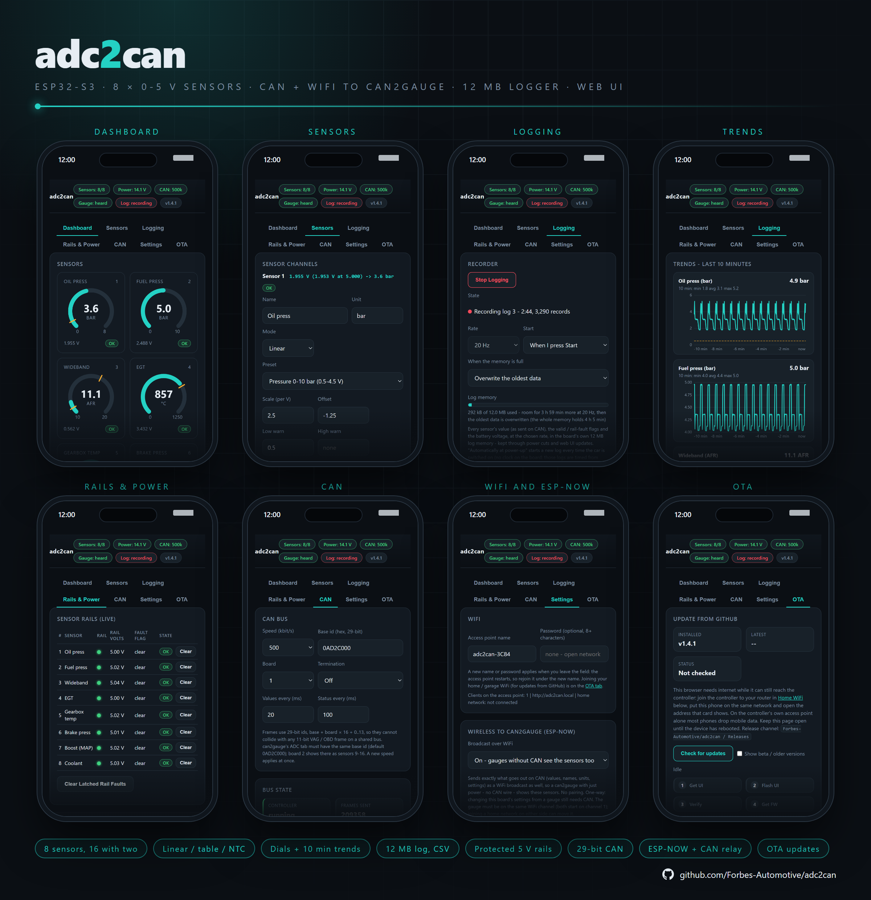

  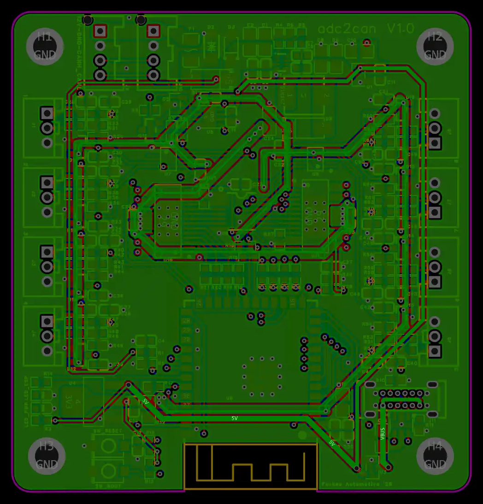

> [!NOTE]
> **Status (firmware 1.4.1, not yet released; board revhb "V1.0").** The firmware is feature complete for a first
> release and everything in the web UI runs today in the bundled simulator (`sim/`), which every web UI image in this
> README was made from. See [Status and Bench Items](#status-and-bench-items) for what still wants its first check on a
> real board.

---

## Contents

- [Features at a Glance](#features-at-a-glance)
- [How It All Links Together](#how-it-all-links-together) - one setting, every place it shows up
- [Getting Started](#getting-started) - wiring, first connection, setting up a sensor
- [Sensors](#sensors) - linear, presets, table, NTC, ratiometric, warnings, smoothing
- [Dashboard](#dashboard) - live values, dials and their ranges, the board, alerts
- [Logging and Trends](#logging-and-trends) - the 12 MB recorder, CSV export, the 10-minute graphs
- [Sensor Rails and Power](#sensor-rails-and-power) - short-circuit and 12 V back-feed protection
- [CAN](#can) - ids, frames, two boards on one bus
- [WiFi to can2gauge](#wifi-to-can2gauge) - ESP-NOW, and relaying the car's CAN to a gauge
- [With can2gauge](#with-can2gauge) - what the gauge shows, and what it can change
- [Settings and Backup](#settings-and-backup)
- [Updating](#updating)
- [Hardware](#hardware) - the board, plugs, pin map, flash layout, enclosure
- [Status and Bench Items](#status-and-bench-items)

---

## Features at a Glance

| Feature | Detail |
|---|---|
| Inputs | 8 × 0-5 V sensors (0-6.3 V usable range), JST PA-3 sockets: switched 5 V, signal, ground. **16** with a second board |
| Readings | Two 16-bit ADS1115 converters, about **180 readings a second per channel**, each corrected against that sensor's own measured 5 V supply |
| Sensor modes | **Linear** (with presets for 0.5-4.5 V pressure senders, 3 bar MAP, wideband AFR / lambda, EGT amplifiers), **Table** (up to 8 volts : value points) and **NTC** thermistor |
| Per sensor | Name (14 characters), unit, low / high warning, decimals, smoothing, gain trim, rail on / off, ratiometric, dial range |
| Sensor supplies | One switched, current-limited (about 0.5 A) 5 V rail per sensor (TPS4H160A), each with its own fault flag and voltage readback. A short only takes out its own sensor |
| Protection | Short / overload: auto-retry or latch off. **12 V back-feed** onto a sensor's 5 V pin: every rail off until it's gone. 12 V input fused, reverse-polarity and surge protected |
| Dashboard | Every sensor as a **dial** or a number, connector volts and state, battery, sensor bus, CAN, ADC chips and rails, with plain-English alerts |
| Data logger | **12 MB** on the board: every sensor, the flags and the battery at 1, 2, 5, 10, 20 or 50 Hz. Start by hand or at power-up; stop or overwrite the oldest when full. Survives power cuts and updates. **CSV** download |
| Trends | The last **10 minutes** of every sensor (1 s averages, kept on the board), with min / avg / max, warning lines and a touch readout |
| CAN | 125 / 250 / 500 / 1000 kbit/s, **29-bit ids** (cannot clash with any 11-bit car frame), switchable 120 Ω termination, up to 4 boards on one bus |
| Shared with can2gauge | Values, connector volts, status, names, units, every sensor setting and the dial ranges; the gauge can **edit** them over CAN |
| WiFi to can2gauge | Every CAN frame also broadcast over **ESP-NOW**, so a gauge with **power only** shows the sensors. Optional **CAN relay**: the car's own CAN frames to the gauge over WiFi too |
| Web UI | 7 tabs on the board's own open access point, settings save as you change them, shared Forbes Automotive theme |
| Updates | Over the air from GitHub or from files (web UI + firmware), 60 s rollback guard |

---

## How It All Links Together

Most settings on the adc2can turn up in more than one place. This is the one picture to keep in mind:

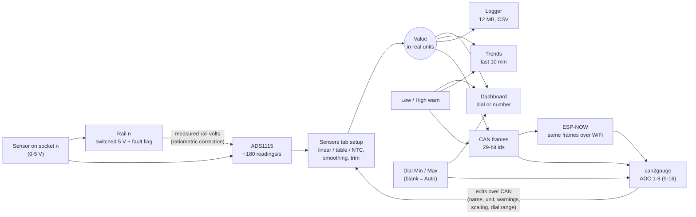

| You set this... | ...on this tab | ...and it also changes |
|---|---|---|
| **Name** and **unit** | Sensors | The dashboard tile, the trend title, the rails table, the log's CSV column heading, and the gauge's label for the sensor (sent on CAN / ESP-NOW) |
| **Mode / scaling** (linear, preset, table, NTC) | Sensors | The value on every page, what's logged and sent, and an **Auto** dial range (here and on the gauge) |
| **Low / High warn** | Sensors | Amber ticks on the dial, the "out of range" state, amber lines on the trend graph and the out-of-range bit in the CAN status frame (the gauge shows it too) |
| **Decimals** | Sensors | The dashboard, the CSV, and the decimals a can2gauge page uses for the sensor |
| **5 V Rail On** | Sensors | Whether the sensor is powered and counted on the Dashboard / Rails & Power; a sensor with its rail off sends "not valid" (NaN) |
| **Ratiometric** | Sensors | The reading is scaled to 5.000 V using that sensor's own rail, so a sagging supply doesn't move the value |
| **Dial Min / Max** | Dashboard > Display options | The dashboard dial and the **same range on any can2gauge page** showing that sensor. Blank = Auto, worked out from the scaling |
| **Board** (1-4) | CAN | The CAN ids (base + board × 16), the address name (`adc2can.local`, board 2 `adc2can2.local`) and where the gauge shows the sensors (board 2 = sensors 9-16) |
| **Base id** | CAN | Must match the base id on the gauge's ADC tab (default `0AD2C000`) |
| **Broadcast over WiFi** | Settings | Whether a gauge without a CAN wire sees the sensors; the **CAN relay** rides on it, so it needs this on too |
| **Home WiFi bridge** | OTA | Moves the board's WiFi channel to the router's: a gauge listening on ESP-NOW must be on the same channel |
| **Logger rate** | Logging | How long the 12 MB lasts (from about 1 h 38 min at 50 Hz to 82 h at 1 Hz) |
| Editing a sensor **on the gauge** | can2gauge ADC tab | Applied here, saved, echoed back and shown on this web UI straight away (needs the CAN wire: ESP-NOW is one-way) |

Every change bumps the board's **config revision**: a can2gauge that sees a new revision asks for the whole config
again, so the gauge and the board never disagree for long.

---

## Getting Started

1. **Wire it.** One of the two 4-pin plugs takes 12 V, ground, CAN-H and CAN-L from the can2gauge chain (or the car);
   the other passes all four straight on to the next device. No CAN wire? Power alone is enough for a can2gauge to show
   the sensors over WiFi (see [WiFi to can2gauge](#wifi-to-can2gauge)).
2. **Plug in the sensors.** Each 3-pin socket: pin 1 switched 5 V, pin 2 signal, pin 3 ground. A sensor with its own
   supply (a wideband controller's output, an EGT amplifier) only needs pins 2 and 3. An NTC temperature sender needs
   a **2.2k pull-up resistor** from pin 1 to pin 2: put it in the loom or plug, or fit the board's own **R_PUn** (R32,
   R37 ... R67 for sensors 1-8, left empty as standard). The picture below shows all three.

  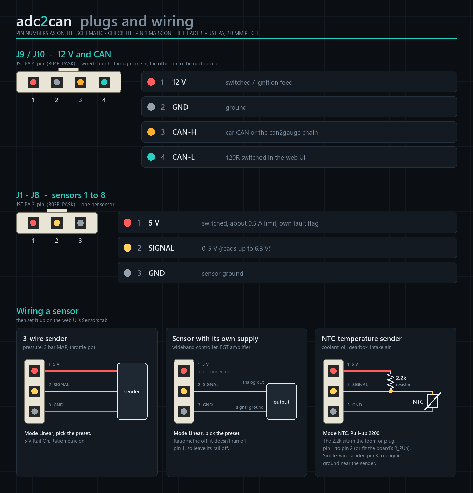

3. **Connect.** Join the open WiFi network **`adc2can-XXXX`** (no password until you set one) and browse to
   **http://192.168.1.1** or **http://adc2can.local** (a second board is `adc2can2.local`).
4. **Set up each sensor** on the **Sensors** tab: name, unit and a preset (or your own scaling). It saves as you type
   and goes out on CAN straight away.
5. **On the can2gauge**, the sensors appear as **ADC 1-8** with the names and units you gave them. Pick one as a
   gauge page's source and its range, warnings and decimals come along with it.

> [!NOTE]
> The sensor supplies come from the car's 12 V. On USB power alone the board, web UI and logger run, but the sensor
> sockets stay off (the web UI says "No 12 V" rather than raising rail faults).

---

## Sensors

The **Sensors** tab has one block per socket, with that socket's live reading at the top: the connector voltage, the
voltage corrected to a 5.000 V supply (ratiometric sensors) and the value it works out to.

- **Name** (14 characters) and **Unit** (7): shown everywhere on the board and sent to the gauge. `C` and `F` show as
  °C / °F, the same as can2gauge shows them.
- **Mode**:
  - **Linear**: value = scale × volts + offset. **Presets** fill it in for common senders: plain volts, 0-100 / 0-150
    psi and 0-7 / 0-10 bar 0.5-4.5 V pressure senders, a Bosch 3 bar MAP (0 261 230 119), wideband AFR (0-5 V =
    10-20) and lambda (0.68-1.36), and an EGT amplifier (0-5 V = 0-1250 °C).
  - **Table**: up to 8 `volts:value` points with straight lines between them, for senders that aren't straight
    (`0.5:0, 2.5:5, 4.5:10`).
  - **NTC**: a thermistor fed from the channel's own 5 V rail through a 2.2k pull-up (external, or R_PUn on the
    board), worked out with the beta model
    (R25, beta and the pull-up value are set here; the board's 10k / 11k input divider is allowed for).
- **Low warn / High warn**: blank for none. Outside them, the sensor shows "out of range" (see
  [How It All Links Together](#how-it-all-links-together) for everywhere that goes).
- **Decimals** (0-4), **Smoothing** (1 = none to 250 = heavy) and **Gain trim** (0.8-1.2, for the divider's resistor
  tolerance).
- **5 V Rail On**: switch the socket's supply on. Leave it off for an empty socket.
- **Ratiometric**: a sensor powered from its own pin 1 (most pressure senders, a MAP sensor, a pot) reads relative to
  its supply. With this on, the reading is scaled to exactly 5.000 V using that rail's measured voltage. Leave it off
  for a sensor with its own supply. An NTC always works off its own rail, so the option is hidden.

  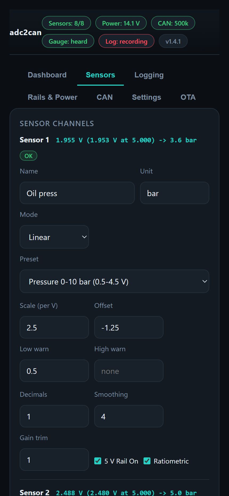
  &nbsp;
  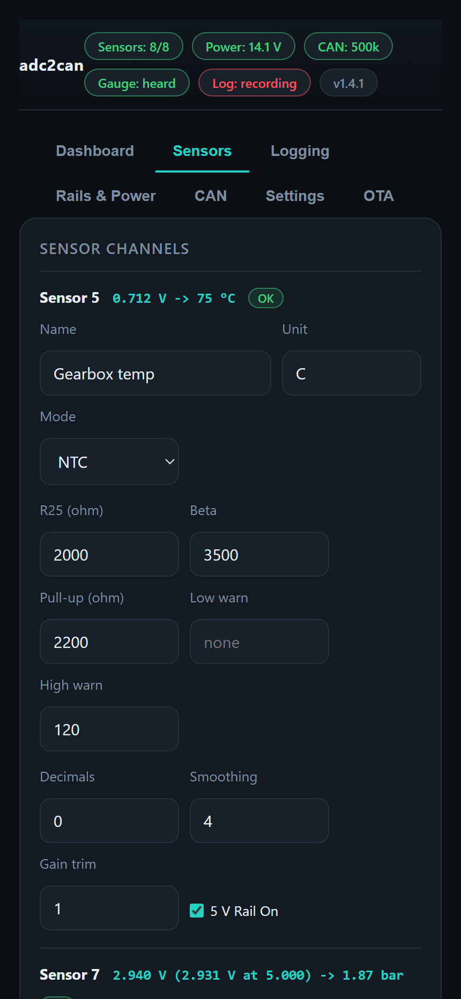

---

## Dashboard

- **Sensors**: one tile per socket with the value (or a **dial**), the connector voltage and its state: OK, out of
  range, no value, rail off, no 12 V, rail fault, latched off or back-feed. The dials sweep once when the page opens,
  like a cluster at ignition on, and mark the low / high warnings with amber ticks.
- **Board**: the sensor 5 V bus, battery, CAN state, when a gauge last talked to the board, the ADC chips and how many
  rails are on (or faulted).
- **Alerts** appear above the tiles when something needs looking at: back-feed, no 12 V, a converter or the fault-flag
  chip not answering, or a rail fault (with a link to [Rails & Power](#sensor-rails-and-power)).
- The badges along the top (Sensors, Power, CAN, Gauge, Log, version) are on every tab.

**Display options**: tick a sensor to show it as a dial instead of a number (remembered by that browser). The two boxes
beside it are the dial's **minimum and maximum**. They're saved on the adc2can and sent to can2gauge with the rest of
the sensor's settings, so a gauge page showing the sensor uses the **same range**. Leave them blank for **Auto**, which
works the range out from the scaling: plain volts 0-5.5 V, a linear sender over its span (0.5-4.5 V for a ratiometric
sender, otherwise 0-5 V), a table's values, -20 to 150 for an NTC, rounded out to a tidy scale. Changing the scaling
moves an Auto range with it.

  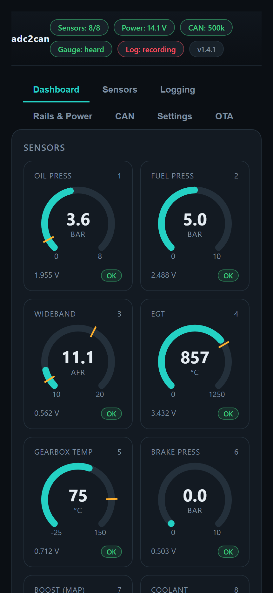
  &nbsp;
  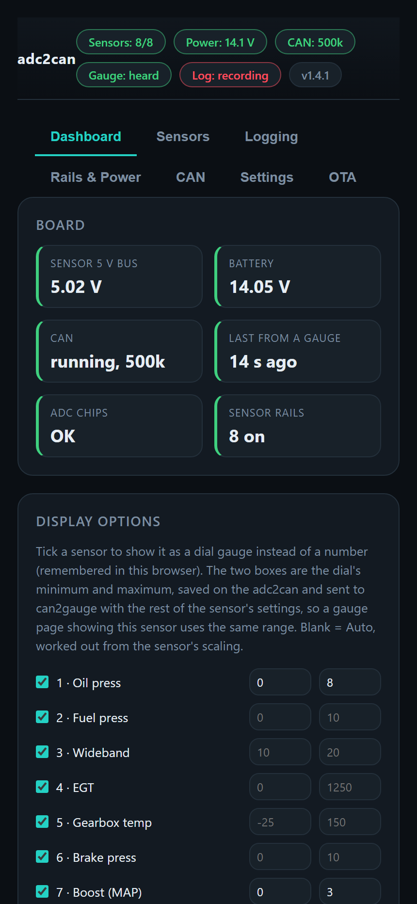

---

## Logging and Trends

The **Logging** tab has the recorder, the logs stored on the board, and the trend graphs.

**Recorder**

- **Start Logging** / **Stop Logging**, or **Automatically at power-up** (a new log every time the car is switched on).
- **Rate**: 1, 2, 5, 10, 20 or 50 Hz.
- **When the memory is full**: stop, or overwrite the oldest data.
- Each record holds every sensor's value (as sent on CAN, blank when not valid), the valid and rail-fault flags and the
  battery voltage.
- The **log memory** bar shows what's used and how much longer the memory lasts at the chosen rate:

| Rate | The whole 12 MB holds |
|---|---|
| 50 Hz | about 1 h 38 min |
| 20 Hz | about 4 h 5 min |
| 10 Hz | about 8 h 11 min |
| 5 Hz | about 16 h |
| 1 Hz | about 82 h |

- The logs live in their own flash partition, so they **survive power cuts and web UI / firmware updates**. A log is
  stored in self-contained 4 kB pieces, so even a log that was partly overwritten still reads back.
- The board has no clock. A log started from the web page takes the phone's date and time; one started at power-up is
  timed from power-up.

**Logs**: every log on the board with its start, length, rate, records and size, and buttons for each:

- **CSV**: decoded in the browser into a spreadsheet (Excel, LibreOffice, MegaLogViewer, any plotting tool): one row per
  record, the time in seconds (plus the date and time when it was started from the page), one column per sensor in its
  units, then the battery and the flag bits.
- **Raw**: the log exactly as stored on the board (`.a2c`).
- Delete one log, or **Delete All Logs**.

**Trends - last 10 minutes**: one graph per sensor, with its current value and the 10-minute min / avg / max. They're
1-second averages kept on the board all the time, so the last 10 minutes are there as soon as the tab opens, logging or
not. The amber dashed lines are the sensor's low / high warnings. Hover or touch a graph to read a value.

  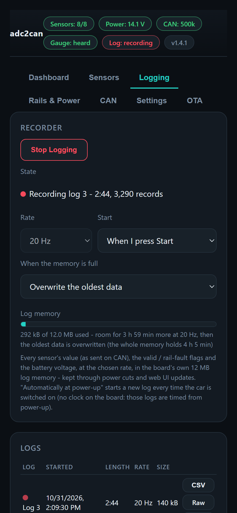
  &nbsp;
  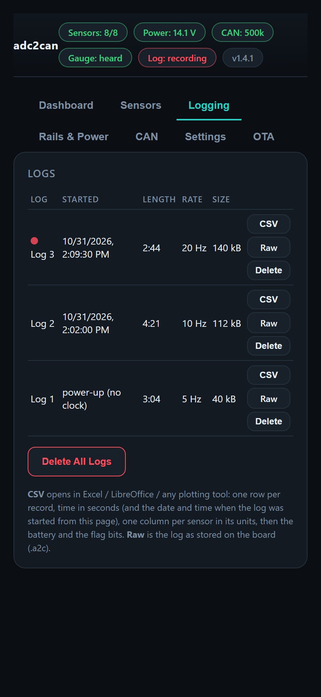
  &nbsp;
  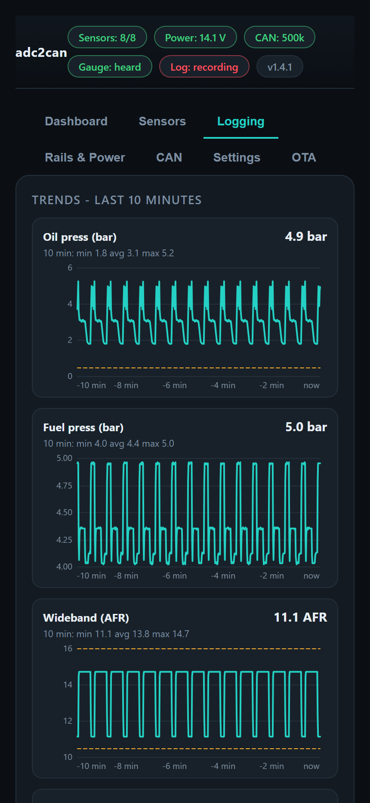

---

## Sensor Rails and Power

Each sensor's 5 V comes through its own channel of a TPS4H160A smart switch, current-limited to about 0.5 A, with a
fault flag the board reads through a TCA9554 and a voltage readback on the ESP32. The **Rails & Power** tab shows them
live: the rail LED, its voltage, the fault flag and the state, with **Clear** per rail and **Clear Latched Rail Faults**.

**Rail protection**

- **On a rail fault**: **Auto-retry** (the rail stays on and the switch retries by itself) or **Latch off until
  cleared**.
- A fault is the switch's fault flag, or the rail falling below **Rail low below** (4.50 V by default), lasting longer
  than **Fault must last** (200 ms by default).
- **Back-feed**: 12 V pushed onto a sensor's 5 V pin (a wiring mistake) lifts the whole sensor bus. Above **Back-feed
  above** (5.80 V) every rail switches off. They come back once the bus is normal again, and never sooner than **Back-feed
  retry** (5 s). The sensor bus is diode-isolated from the board's own supply, so the logic keeps running.

**Power**

- **Battery low / high** (11.0 / 15.5 V): sent in the CAN status frame and shown on the badge.
- **No 12 V below** (7.0 V): the board is on USB alone, so the sensor supply is off and rail faults aren't raised.

  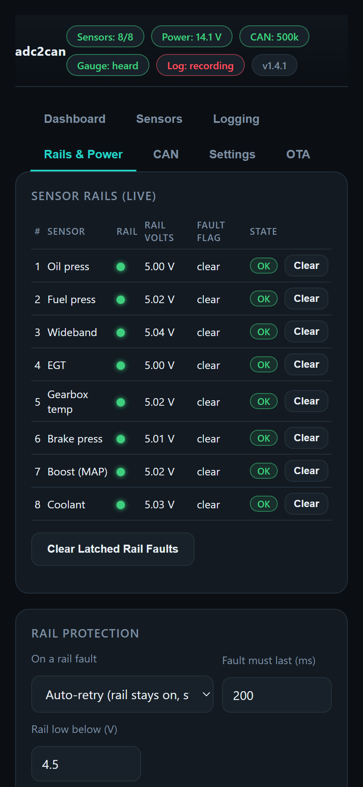
  &nbsp;
  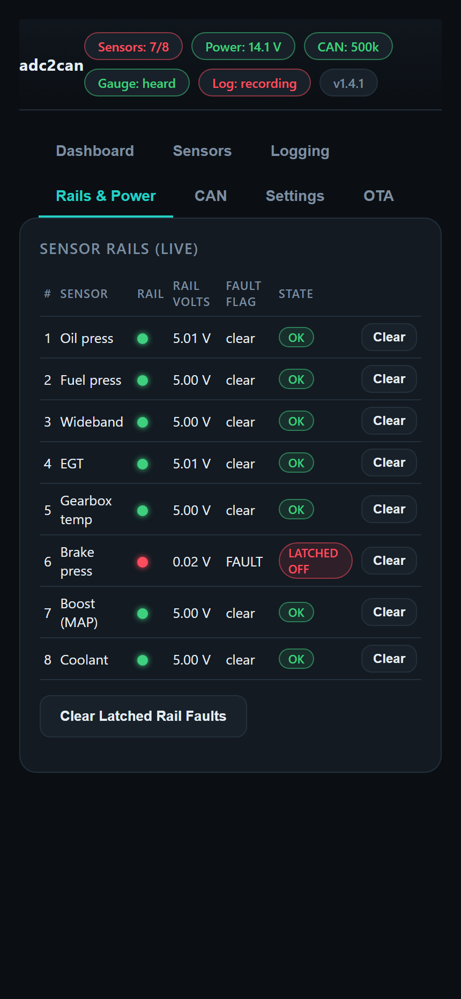

---

## CAN

**CAN bus**: speed (125 / 250 / 500 / 1000 kbit/s, applies at once), **base id** (29-bit, default `0AD2C000`),
**board** (1-4), **termination** (120 Ω on for the last node on the bus) and how often the values (20 ms = 50 Hz) and
status (100 ms) go out. **Bus state** shows the controller, frames sent, send errors, the error counters and what's been
heard from a gauge. **Frames** lists every id with what it carries, how many have gone and the last data.

Frames use 29-bit ids, `base + board × 16 + n`, so they can never collide with an 11-bit VAG / OBD frame on a shared
bus. At the defaults they take about 8 % of a 500 kbit/s bus.

| n | What |
|---|---|
| 0-3 | Sensor 1+2, 3+4, 5+6, 7+8 values: float32 big-endian in real units (NaN when not valid) |
| 4 | Status: valid, rail-on, rail-fault and out-of-range masks; flags (back-feed, battery low / high, each ADC chip, the flag chip, no 12 V); sensor bus; battery mV |
| 5 | Name / unit descriptor, cycling through the 8 sensors |
| 6-7 | Connector voltage of sensors 1-4 / 5-8 (mV) |
| 8 | Config part: every sensor setting, 32 parts per sensor (the last two are the dial range in use) |
| 9 | Config info: revision, firmware version, protocol, parts per sensor |
| 12 | **From a gauge**: request the config (one sensor or all), or clear a latched rail fault |
| 13 | **From a gauge**: set one config part (applied, saved, echoed back as n 8) |

The whole config also cycles out slowly in the background (all of it in about 24 s) and goes out in full after any
change. The full byte layout is in the header of `src/adc2can_can.cpp`, so any dash, logger or ECU that can read a
custom CAN stream can use the adc2can too.

**Two boards on one bus**: set the second one to **Board 2**. Its ids move up by 16, it answers at `adc2can2.local`, and
can2gauge shows its sensors as 9-16.

  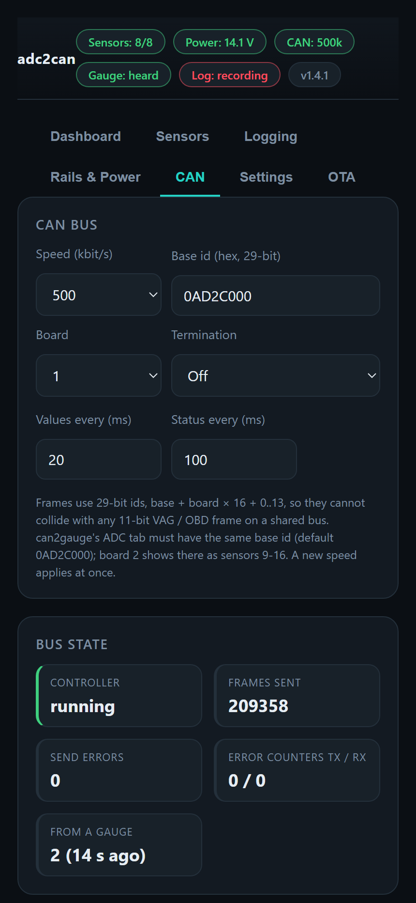

---

## WiFi to can2gauge

**Broadcast over WiFi** (Settings, on by default): every frame that goes out on CAN is also broadcast over **ESP-NOW**,
unchanged: values, connector volts, status, names / units, the config and the info frame. A can2gauge (0.8.0 or newer)
decodes them exactly like CAN frames, so **a gauge with just power shows the sensors**. The frames are built and sent
even with no CAN bus at all.

- No pairing. The gauge has to be on the **same WiFi channel** (both start on channel 1). Joining a home network
  (the **Home WiFi** bridge on the OTA tab, on either side) moves that device's channel to the router's.
- **One-way**: nothing is received over the air. The gauge gets the full config from the slow background cycle (about
  24 s), and changing the adc2can's settings from a gauge needs the CAN wire (or this web UI).
- The card shows the channel and how many packets have gone.

**Relay CAN frames to gauges**: sends every frame the board **receives from the car's CAN** to can2gauge over WiFi as
well, so a gauge with power only reads the car as if it were wired: its CAN profile, CAN monitor, DBC and user signals.
Use it when the adc2can is on the car's bus and the gauge isn't. Turn the relay on on the gauge too (its CAN tab, under
More Options).

- **Every frame**, or each id capped at **50, 20 or 10 a second**. A busy 500 kbit/s bus is around 2000 frames a
  second; if the status line shows frames lost, cap each id's rate.
- It rides on the WiFi broadcast above, so that has to be on too. It's the same relay as OpenHaldex's.

  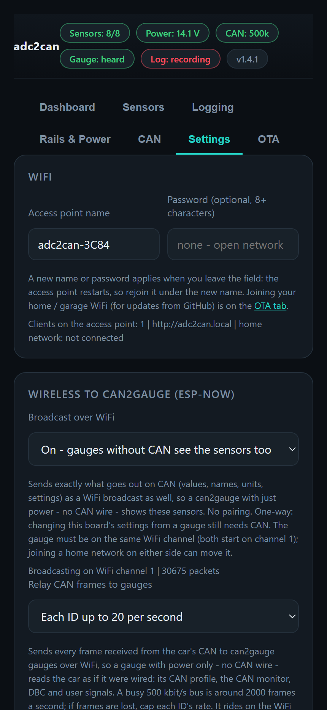

---

## With can2gauge

What the gauge does with the adc2can, end to end:

- **Signals ADC 1-8** (9-16 from a second board) carry the names and units set here. Pick one as a gauge page's
  source and its **range** (the dial range above), **warnings** and **decimals** come from the adc2can.
- **The gauge's ADC tab** shows every adc2can sensor's setup and live state, and can **edit** it: name, unit, mode,
  scaling, warnings, smoothing, trim, rail, ratiometric and the dial range. Edits go over CAN, are saved on the adc2can
  and show on this web UI straight away. The gauge can also clear a latched rail fault.
- The gauge's ADC tab must use the same **base id** as the adc2can (default `0AD2C000` on both).
- A sensor can also be scaled on the gauge alone, but scaling it here keeps the board's own dashboard, logs and CAN
  output in step.
- Version notes: ESP-NOW needs can2gauge 0.8.0+, and the shared dial range 0.36.4+. Older gauges ignore what they don't
  know.

---

## Settings and Backup

- **WiFi**: the access point's name and an optional password (8+ characters; blank = open). A new name or password
  applies when you leave the field, and the access point restarts, so rejoin it under the new name. The card shows the
  clients connected, the board's address and the home network.
- **Device**: **Reboot**, **Download Settings Backup** (a `.json` of every setting), **Restore Backup** and **Factory
  Reset**. The line below shows the firmware, uptime, free memory and config revision.
- Settings save as you change them; there are no Save buttons. Settings from an older firmware carry over on an
  update.

  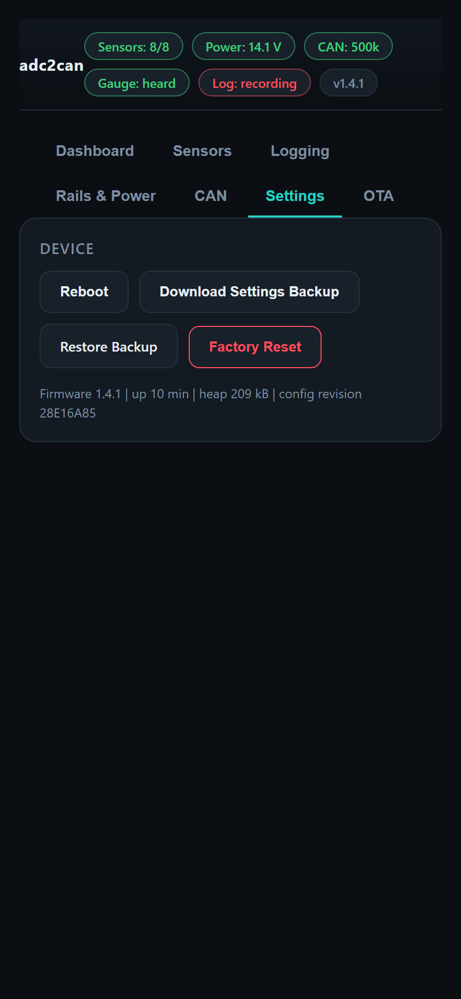

---

## Updating

**Over the air**, from the **OTA** tab (the shared Forbes Automotive OTA):

1. **Update from GitHub**: the board fetches the release list from `Forbes-Automotive/adc2can` and installs the web UI,
   then the firmware. The phone needs internet while it can still reach the board, so join the board to your router
   with **Home WiFi (Bridge Mode)** first, put the phone on the same network and open the address shown.
2. **Update from Files**: download `littlefs.bin` and `firmware.bin` from the newest `Releases/V…` folder and upload
   them, web UI first.

A new firmware boots "pending" and confirms itself after 60 s of healthy running, or the board rolls back to the
previous one. Sensors keep reading and going out on CAN while an update is written. The logs are never touched.

**Over USB** (a new board, or one on firmware older than the 12 MB logger): the
[Forbes Automotive module updater](https://forbes-automotive.com/pages/module-software-updater) flashes it from Chrome or Edge.

> [!NOTE]
> The flash layout (below) has to be written over USB once. An over-the-air update can't change it.

  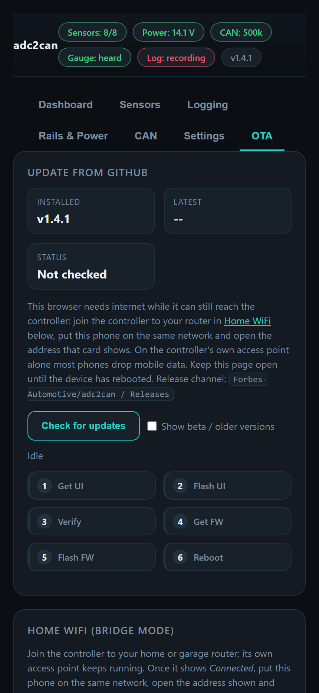

---

## Hardware

### The Board

  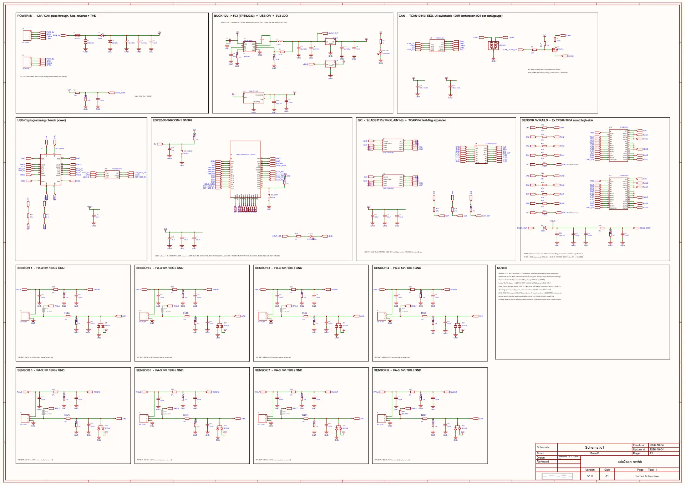

- **ESP32-S3-WROOM-1-N16R8** (16 MB flash, 8 MB PSRAM), USB-C for flashing and bench power, BOOT / RESET buttons and a
  status LED (slow blink when all is well, fast on a fault, dark with no ADC).
- **12 V in**: 1.3 A resettable fuse, reverse-polarity diode, TVS surge protection, TPS62933 buck to about 5.2 V, 3.3 V
  regulator; the same front end as can2gauge.
- **CAN**: TCAN1044V transceiver with ESD protection and a 120 Ω terminator switched from the web UI.
- **Sensor bus**: the buck's output through a diode, so 12 V on a sensor pin can't back-feed the logic, and sensor current
  never goes through the USB power path.
- **Rails**: 2 × TPS4H160A (4 channels each), about 0.51 A current limit per channel, fault flags to a TCA9554, each rail
  read back by the ESP32.
- **Inputs**: 10k / 11k divider (0-6.3 V range), filter and clamp diodes into 2 × ADS1115 (16-bit, ±4.096 V range).
  Pull-up **R_PUn** (R32, R37 ... R67; 2.2k, not fitted as standard) from each channel's own rail for an NTC sender,
  or the same 2.2k fitted externally between the plug's pins 1 and 2.
- **4-layer PCB**, 4 × M3 mounting holes, antenna keep-out at the board edge.

### Plugs

| Plug | Pin 1 | Pin 2 | Pin 3 | Pin 4 |
|---|---|---|---|---|
| J9 / J10: power / CAN (JST PA-4, wired straight through) | 12 V | GND | CAN-H | CAN-L |
| J1-J8: sensors 1-8 (JST PA-3) | Switched 5 V | Signal (0-6.3 V) | GND | |

The wiring examples are in [Getting Started](#getting-started).

### ESP32-S3 Pin Map

| GPIO | Use | GPIO | Use |
|---|---|---|---|
| 3, 9, 10, 1, 4, 5, 6, 7 | Rail readback, sensors 1-8 | 14, 21, 47, 48, 15, 16, 17, 18 | Rail enable, sensors 1-8 |
| 8 | Sensor bus readback | 13 | Rail fault reporting on |
| 2 | Battery readback | 42 | Fault-flag chip interrupt |
| 11 / 12 | I2C SDA / SCL (ADS1115 0x48 / 0x49, TCA9554 0x20) | 40 | CAN termination (low = on) |
| 38 / 39 | CAN TX / RX | 41 | Status LED |

(`src/adc2can_pins.h`, matching the revhb board.)

### Flash Layout

`partitions_16mb.csv`: two 1.75 MB firmware slots (the firmware is about 1.2 MB), a 384 kB web UI partition and the
**12 MB logs** partition. The logs partition has its own type, so neither a web UI update nor the release tools ever
touch it.

### Enclosure

`enclosure/`: the printable housing and base (STL). Keep any metal clear of the ESP32-S3 antenna.

---

## Status and Bench Items

The firmware runs end to end in the simulator. These want their first check (or a re-check) on a real revhb board:

- **Bring-up on revhb**: the pin map moved to the revhb board's in firmware 1.3.x (`src/adc2can_pins.h`). Rails,
  readbacks, CAN and the status LED on the real board.
- **Rail protection**: the 0.51 A limit, a real short on a sensor's 5 V (auto-retry and latch), and 12 V on a 5 V pin
  tripping the back-feed cut-off.
- **NTC senders** with R_PUn fitted, against a thermometer.
- **Logger**: a long 50 Hz log in the car, and auto-start across many key cycles.
- **ESP-NOW** range and the **CAN relay** on a busy 500 kbit/s car bus, with a can2gauge on power only.

---

## Disclaimer

Forbes Automotive accepts no responsibility for any incidents arising from the use of this board. Check each sensor's
scaling against a known reading before relying on a value, warning or log, and wire sensors with the power off.
